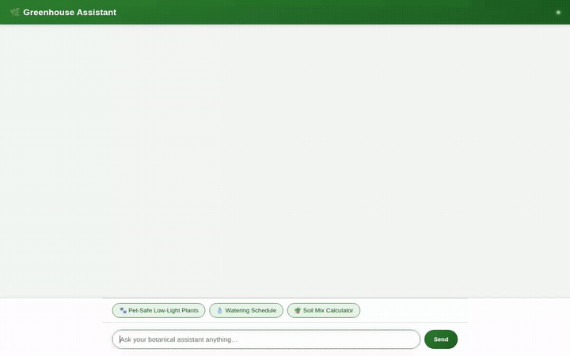

# 🌿 Greenhouse Assistant

An intelligent botanical concierge and houseplant care agent built with the Google Agent Development Kit (ADK) and Gemini on Google Cloud Vertex AI.



---

## 📖 Overview

Greenhouse Assistant helps plant owners select, care for, and troubleshoot indoor houseplants. It couples LLM conversational abilities with structured database lookups, persistent cross-session memory, public cloud media delivery, code execution in an isolated sandbox, and visual UI rendering via A2UI.

---

## 🛠️ Implemented Features & Google Cloud Services

Based on the agent's codebase (`app/agent.py` and `agents-cli-manifest.yaml`), the following services and capabilities are implemented and wired up:

### 1. Vertex AI Memory Bank (Long-Term Cross-Session Memory)
* **Preload Tool**: Uses `PreloadMemoryTool()` to pull past conversational context, home environment specs, and user preferences into the system context on every turn.
* **Extraction Callback**: Hooks into `generate_memories_callback` (`after_agent_callback`) via `callback_context.add_session_to_memory()` to automatically distill plant collection details, lighting conditions, and pet ownership into long-term memory across sessions.

### 2. Google Cloud Firestore (Botanical Catalog & Inventory)
* **`list_plants`**: Filters the catalog collection by light requirements (`low`, `indirect`, `bright`), pet safety (non-toxic for cats and dogs), and maximum watering intervals.
* **`get_plant_details`**: Retrieves in-depth botanical specifications, ideal temperature ranges, humidity preferences, soil composition, and propagation advice.
* **`add_plant`**: Allows users to record newly adopted plants directly into the Firestore collection.

### 3. Agent Engine Code Execution Sandbox
* **`AgentEngineSandboxCodeExecutor`**: Executes Python code in a secure, isolated Agent Engine environment to compute custom, multi-variable soil mix recipes and dynamic watering adjustments.

### 4. Cloud Storage & Multimodal Media Generation
* **Houseplant Image Generation (`generate_plant_image`)**:
  * Uses `gemini-3.1-flash-lite-image` to generate photorealistic plant renderings.
  * Saves the image as an in-session artifact via `tool_context.save_artifact`.
  * Uploads image bytes directly to a public Cloud Storage bucket and returns the public HTTPS URL.
* **Omni Video Generation (`generate_plant_video`)**:
  * Uses Google's Omni model (`gemini-omni-flash-preview`) in the Vertex AI `global` region via the Interactions API to generate cinematic botanical time-lapses.
  * Saves video bytes with `tool_context.save_artifact` for display in the Playground's Artifacts panel.
  * Streams video bytes straight to the public Cloud Storage bucket and returns the public HTTPS URL.

### 5. A2UI (Agent-to-User Interface)
* Formats catalog listings, plant details, care instructions, and safety warnings into interactive rich cards, columns, dividers, headers, and media elements using the A2UI catalog protocol (`a2ui_callback` after-model interceptor).

### 6. External Location & Climate Tools
* **`calculate_watering_schedule`**: Deterministic seasonal watering frequency adjustment.
* **`get_local_climate`**: Current temperature and humidity lookup via Open-Meteo API.
* **`geocode_address` & `find_nearby_places`**: Google Maps Platform geocoding and local nursery/greenhouse discovery.

---

## 📋 Status of Planned Capabilities

* **Implemented**: Vertex AI Memory Bank, Firestore Catalog, Agent Engine Sandbox Code Execution, Cloud Storage Public Asset Hosting, Gemini Image Generation, Gemini Omni Video Generation, A2UI Component Cards, Geocoding & Local Greenhouse Finder.
* **Planned, not yet implemented**: Cloud Trace custom telemetry hooks for end-to-end latency profiling.

---

## 🚀 Running the Project Locally

To run the agent and its botanical chat web interface on your local machine:

### 1. Prerequisites
* Python 3.11+
* Google Cloud SDK (`gcloud`) authenticated to your GCP project
* Application Default Credentials configured:
  ```bash
  gcloud auth application-default login
  ```

### 2. Set Up the Agent Environment
Clone this repository and navigate to the agent directory:
```bash
cd greenhouse-agent
python3 -m venv .venv
source .venv/bin/activate
pip install -r requirements.txt
```

### 3. Run with ADK Web UI
To interact with the agent using the built-in ADK Playground:
```bash
adk web app
```

### 4. Run the Standalone Chat Frontend
To run the botanical web chat interface:
```bash
cd frontend
pip install -r requirements.txt
python main.py
```
Then open your browser to the local server address displayed in the terminal.

---

## 📁 Repository Structure

```
├── README.md                      # Project documentation and architecture guide
├── demo.gif                       # Looping screen recording of the agent in action
├── project_brief.md               # Original project brief and tool coverage goals
└── greenhouse-agent/
    ├── agents-cli-manifest.yaml   # ADK agent deployment manifest
    ├── pyproject.toml             # Python dependencies and packaging configuration
    ├── app/
    │   ├── agent.py               # Root agent, tools, callbacks, and sandbox executor
    │   ├── a2ui_prompt.py         # A2UI system instructions and catalog schema
    │   ├── a2ui_utils.py          # A2UI after-model callback and payload unpacker
    │   └── fast_api_app.py        # ADK FastAPI application wrapper
    └── frontend/
        ├── main.py                # FastAPI proxy communicating over A2A protocol
        ├── requirements.txt       # Frontend proxy dependencies
        └── static/
            └── index.html         # Dialogue layout and A2UI client-side renderer
```
